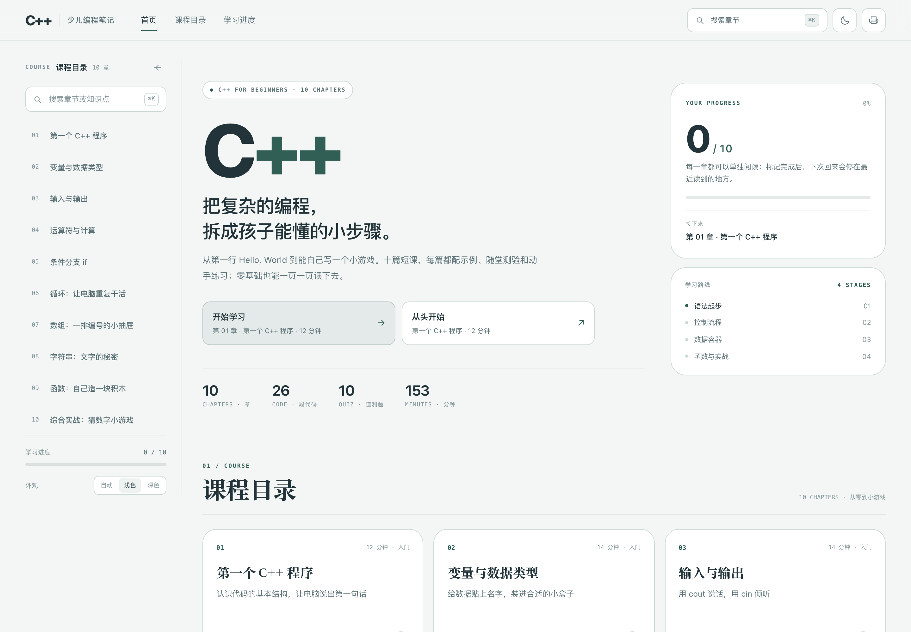
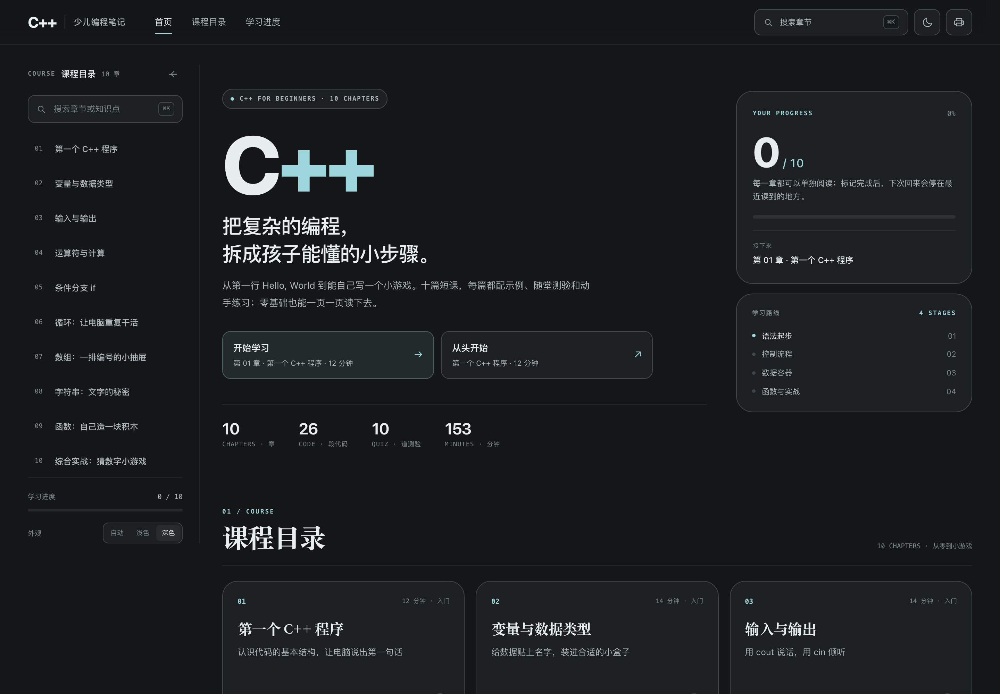
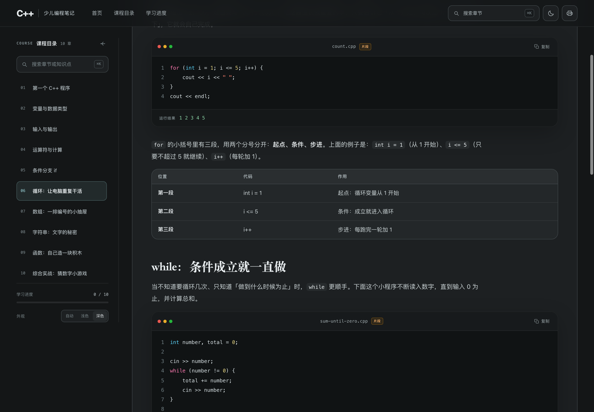
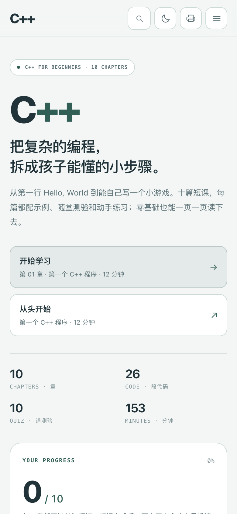
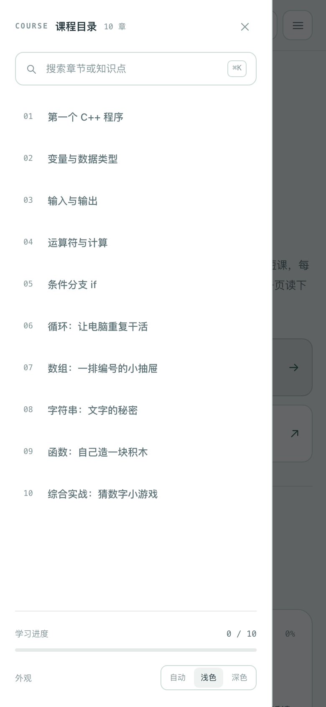

# C++ 笔记 · 少儿编程入门

一套写给 10 岁左右孩子的 C++ 入门笔记：10 章、26 个代码示例、10 道随堂测验、10 个动手练习。全屏深色卡片式排版，纯静态、无依赖、离线可用。

| 浅色模式 | 深色模式 |
| --- | --- |
|  |  |






## 快速开始

**方式一：直接打开**

双击 `index.html`，用 Safari / Chrome 打开即可。

**方式二：本地服务器（推荐）**

```bash
python3 -m http.server 4173
```

然后访问 <http://127.0.0.1:4173>。

> 直接双击也能正常阅读；用本地服务器可以让 `localStorage` 进度和主题在所有章节间稳定保存。

## 页面结构

- **首页**：巨型 `C++` 字标、学习进度卡、四段学习路线、10 张课程卡、使用方法。
- **章节页**：章节标题与目标卡、正文大卡、代码卡、随堂测验、练习、要点、上一章/下一章。
- **左侧课程栏**：章节目录、搜索、总进度、外观切换；桌面端可收成 72px 窄轨，移动端变成抽屉。
- **顶栏**：首页 / 课程目录 / 学习进度快捷入口、搜索、主题切换、打印。

## 课程目录

| # | 章节 | 关键词 | 难度 |
| --- | --- | --- | --- |
| 01 | 第一个 C++ 程序 | `main`、`cout`、编译、分号 | ★☆☆ |
| 02 | 变量与数据类型 | `int`、`double`、`bool`、`string` | ★☆☆ |
| 03 | 输入与输出 | `cin`、`cout`、交互 | ★☆☆ |
| 04 | 运算符与计算 | 算术、取余、比较、`bool` | ★★☆ |
| 05 | 条件分支 if | `if`、`else if`、逻辑运算 | ★★☆ |
| 06 | 循环：让电脑重复干活 | `for`、`while`、累加 | ★★☆ |
| 07 | 数组：一排编号的小抽屉 | 下标、遍历、最大值 | ★★★ |
| 08 | 字符串：文字的秘密 | 拼接、下标、比较、范围遍历 | ★★★ |
| 09 | 函数：自己造一块积木 | 参数、返回值、复用 | ★★★ |
| 10 | 综合实战：猜数字小游戏 | 随机数、循环、条件综合 | ★★★ |

## 功能

- **深色首页 dashboard**：巨型字标、进度卡、学习路线、课程卡片网格，默认深色。
- **三种外观**：自动跟随系统、浅色、深色；选择会保存，并在首屏渲染前应用，避免闪白。
- **课程抽屉 / 窄轨**：桌面端点击「收起目录」变为 72px 窄轨；980px 以下变为可滑出的抽屉。
- **全文搜索**：`⌘K` / `Ctrl+K` 聚焦搜索框，按章节标题、关键词和正文过滤。
- **语法高亮**：C++ 行号、关键字、字符串、注释、预处理指令高亮，附运行结果；代码卡带 macOS 三色窗点。
- **标记「片段」**：不能单独编译的局部示例会自动显示橙色「片段」标签，避免孩子把片段当成完整程序。
- **随手测验**：每题有即时正误反馈和解释，可重试。
- **动手练习**：每章一个练习，带提示和参考写法。
- **学习进度**：章节底部完成按钮、侧栏进度、首页进度卡同步更新，保存在 `localStorage`。
- **继续学习**：首页按钮读取最近一次阅读的章节，没有记录时从第 1 章开始。
- **打印**：打印按钮只打印当前章节，自动切换为白底黑字。
- **键盘操作**：`←` / `→` 切换章节，`Esc` 关闭移动端目录 / 清空搜索。

## 文件结构

```text
.
├── index.html          # 顶栏、课程栏、首页 / 章节容器、页脚
├── assets/
│   ├── styles.css      # 设计令牌、首页与章节样式、响应式、打印
│   ├── course.js       # 10 章课程内容
│   ├── app.js          # 首页渲染、路由、搜索、测验、进度、主题
│   └── favicon.svg
├── screenshots/
└── README.md
```

没有构建步骤，没有 npm 依赖，也没有外部网络请求。

## 修改课程

课程都在 `assets/course.js` 的 `COURSE` 数组里，一章对应一个对象：

```js
{
  id: 'c1',
  slug: 'hello-world',
  num: '01',
  title: '第一个 C++ 程序',
  subtitle: '认识代码的基本结构，让电脑说出第一句话',
  minutes: 12,
  level: 1,
  keywords: ['Hello World', 'include', 'main', 'cout'],
  goals: ['看懂一个最小 C++ 程序', '用 cout 输出一句话'],
  blocks: [/* 内容块 */]
}
```

支持的块类型：

| `type` | 作用 |
| --- | --- |
| `h2` | 小节标题 |
| `p` | 段落 |
| `list` | 列表；`ordered: true` 显示编号 |
| `table` | 表格，`headers` + `rows` |
| `code` | 代码卡，`file`、`code`、`output` |
| `tip` / `warn` / `note` | 提示 / 警告 / 补充说明 |
| `quiz` | 选择题，`question`、`options`、`answer`、`explain` |
| `exercise` | 动手练习，`title`、`task`、`hint`、`answer`、`answerCode` |
| `takeaways` | 本章要点，`items` |

文字里可以用 `<code>` 包住行内代码，也允许 `<strong>`。**正文中的尖括号要写成 `&lt;` / `&gt;`**，否则会被浏览器当成 HTML 标签吃掉，例如：

```js
'<code>#include &lt;iostream&gt;</code> 用来引入输入输出工具箱。'
```

代码块里的 `code` 使用模板字符串原样保留缩进。判断是否为完整程序只看两点：是否含 `#include <...>`、是否含 `int main(...)`；缺少任一项就会显示「片段」标签。

路由只有两种：`#/home`（默认）与 `#/章节slug`。主题和颜色令牌在 `assets/styles.css` 顶部的 `:root` 与 `[data-theme="dark"]` 中调整；首页 hero、课程卡、正文卡与侧栏宽度也都在同一份样式里。

## 设计说明

版式灵感来自 [DTOJ](https://dtoj.team/) 的深色卡片与衬线标题，采用炭黑底、1px 细边、24px 大圆角、淡青强调色和宋体标题；页面结构、课程内容与交互均为本项目独立实现。正文优先使用系统字体栈（Open Sans / 苹方 / 宋体），不加载网络字体。

## 兼容性

- Chrome / Edge / Safari 最新版。
- 980px 以下切换为顶栏简化 + 抽屉目录；320px 宽度下正文与代码卡无页面横向溢出（超长代码行在卡片内横向滚动）。
- 没有 JavaScript 时会显示提示，不会白屏。

## 说明

- 代码示例按 `-std=c++17` 编写；所有完整程序都通过 `g++` 编译检查。标「片段」的示例需要补上 `#include` 和 `main` 才能单独编译，这是课堂讲解的局部片段。
- 学习进度只保存在本机浏览器，不会上传。
- 课程内容可自由用于个人或课堂教学。
